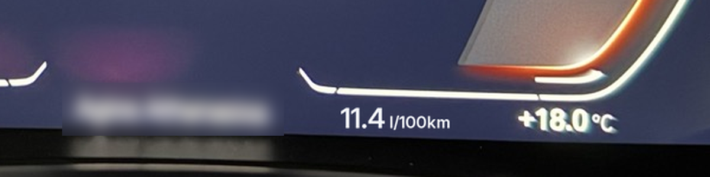
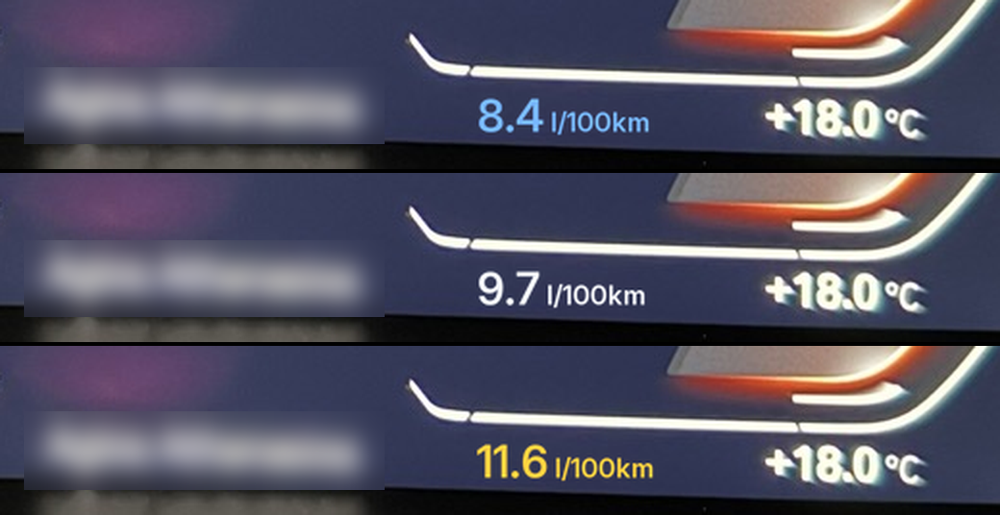
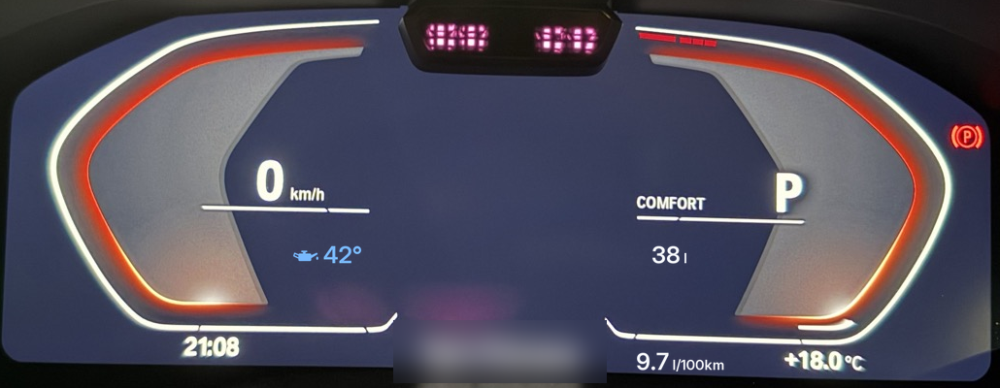
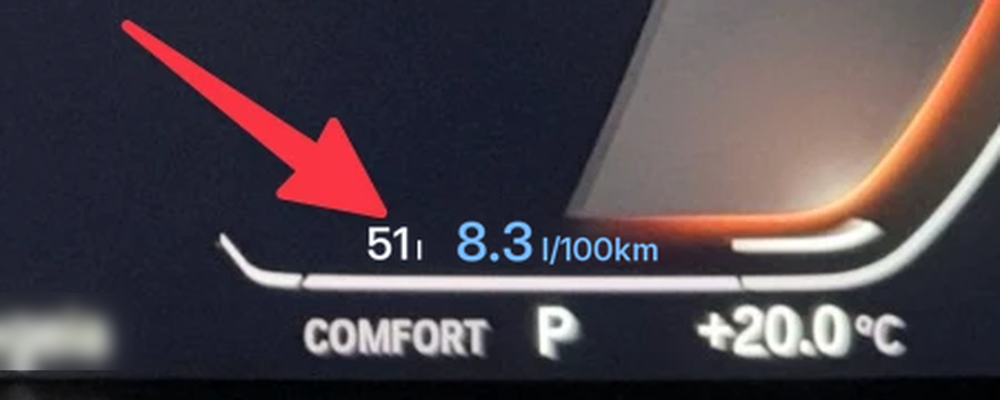

# Расход на приборке (barin-fuel)

> **English:** a minimalist add-on for the stock BMW iDrive 7 instrument cluster (MGU Store tool, built on
> [cluster-render](https://github.com/robertnisipeanu/idrive-apps)). It keeps BMW's clean factory look and adds only a
> few small readouts in BMW's own style: average fuel consumption (coloured by value), litres left in the tank
> (yellow / red when the range gets low) and an oil warm-up indicator while the oil is cold. Configured from a USB
> stick, no SSH needed. Tested on a G16 840 Gran Coupe (2023). Store source: `barinOdUa/bmwcluster`, branch `main`.
> Docs below are in Russian.

Инструмент для MGU Store (BMW, iDrive 7). Показывает средний расход из бортового компьютера в нижней полосе
заводской приборки, слева от температуры за бортом. Остальная приборка не меняется.



Цвет зависит от расхода: **меньше 9** - голубой, **от 9 до 10.5** - белый, **больше 10.5** - жёлтый.



По желанию ещё два показателя, **по умолчанию выключены** (включаются с флешки):

- **Прогрев масла** (`oil_enabled`): голубая маслёнка и температура масла, пока оно холоднее 80°. На 80° на 4 секунды
  становится зелёной и пропадает до следующего холодного старта (масло остыло ниже 70°). Сигнал
  `CDS.statusEngineTemperature`, тот же, что у значка прогрева `asloocod` на X6.
- **Литры в баке** (`tank_enabled`): остаток топлива, `KombiIF.statusRangeTankStatus.fluidLevelFuelTank`. Усредняется
  за 10 секунд, чтобы не прыгал на поворотах. Жёлтые при запасе хода 70 км и меньше, красные при 50 км и меньше
  (запас хода берётся из той же посылки приборки, `range`).



- **Откуда цифра:** приборка сама отдаёт свой бортовой компьютер, `KombiIF.statusBordcomputerAverage`
  (`consumptionAverage1BC1` или `consumptionAverage2BC2`, шаг 0.1). Ничего не считаем.
- **Чем рисует:** Cluster renderer (`cluster-render` из `robertnisipeanu/idrive-apps`), цель `panel`.
- **Машину только читает.** Никаких команд в блоки не отправляет.
- **SSH не нужен:** настройки и отчёт через USB-флешку.

Шрифт - Inter (SIL OFL), ближайшая свободная замена BMW Type Next. Первая версия заодно ищет шрифты на самом
головном устройстве и пишет список на флешку.

## Установка

1. В Store должен стоять **Cluster renderer**: источник `robertnisipeanu/idrive-apps` (он там по умолчанию).
2. Репозиторий приватный, поэтому Store нужен доступ к нему. Так сделано сейчас:
   - в Store: **Settings** → **Accounts** → **Sign in with GitHub** (аккаунт `barinOdUa`);
   - на репозитории стоит [mgu-store GitHub App](https://github.com/apps/mgu-store), только на `bmwcluster`,
     только чтение (github.com → Settings → Applications → mgu-store → Configure).

   Запасной путь - токен: github.com → Settings → Developer settings → Fine-grained tokens → без срока, только
   `bmwcluster`, **Contents: Read-only**; в Store **Accounts** → **Add token**.
3. В Store: **Settings** → **Add source** → `barinOdUa/bmwcluster` → канал **branch** (ветка `main`).
   Вводить на экране машины: страница Phone access не открывается, когда машина сама подключена к хотспоту
   телефона.
4. Установить **Fuel on cluster** (barin-fuel), затем перезапустить головное устройство (Settings → **Restart head unit**).

Новые версии приходят в Store как обновления: Update, затем перезапуск.

## Как стоит сейчас (G16)

Когда наш слой на приборке, BMW переносит «COMFORT P» в нижнюю полосу. Литры начинаются от чёрной черты на белой линии
над COMFORT, расход сразу за ними, оба размером с COMFORT; маслёнка по центру под «0» скорости, под чертой, обе надписи над белой линией:



```json
{ "scale": 0.71, "align": "left", "x": 1302, "y": 594, "tank_x": 1227, "tank_y": 594,
  "unit_label": "l/km", "unit_scale": 0.8, "oil_enabled": true, "tank_enabled": true,
  "oil_x": 423, "oil_y": 414, "oil_align": "center" }
```

Файл целиком: `dev/config-g16.json`.

## Флешка

На флешке в корне создать папку **`barin-fuel`**. Флешки без этой папки инструмент не трогает.

| Файл | Кто пишет | Что это |
|---|---|---|
| `barin-fuel/config.json` | ты | настройки; подхватываются примерно за 10 секунд и сохраняются в машине |
| `barin-fuel/report.txt` | машина | что видит инструмент: значения BC1 и BC2, состояние Cluster renderer, журнал |
| `barin-fuel/fonts.txt` | машина | шрифты, найденные на головном устройстве (через 2 минуты после запуска) |

### Первый запуск: подобрать место

Положить на флешку `barin-fuel/config.json`:

```json
{ "test_pattern": true }
```

Появится рамка с цифрой `88.8`. Двигать её через `x` и `y` (пиксели приборки 1920×720, левый верхний угол рамки),
например `{ "test_pattern": true, "x": 1240, "y": 655 }`. Когда место найдено, убрать `test_pattern` или поставить
`false`.

### Все настройки

| Ключ | По умолчанию | Что это |
|---|---|---|
| `x`, `y` | 1230, 652 | левый верхний угол рамки на приборке |
| `w`, `h` | 300, 60 | размер рамки |
| `baseline` | 46 | базовая линия текста от верха рамки |
| `gap` | 6 | отступ между числом и единицами |
| `align` | `"left"` | `"left"`: текст начинается от `x`; `"right"`: кончается у `x + w`; `"center"`: по центру рамки |
| `scale` | 1 | 0.3-2, текст крупнее или мельче |
| `oil_scale`, `tank_scale` | 0 | свой размер масла и литров; 0 - как `scale` |
| `oil_align`, `tank_align` | `""` | своё выравнивание; пусто - как `align` |
| `counter` | 1 | 1 или 2: какой счётчик бортового компьютера показывать |
| `show_unit` | true | показывать единицы расхода |
| `unit_label` | `""` | своя подпись единиц, например `"l/km"`; пусто - как в машине (`l/100km`) |
| `unit_scale` | 1 | 0.5-1.5, размер подписи единиц расхода |
| `color_by_value` | true | цвет по расходу (только для l/100km); `false`: всегда `color` |
| `low_below` | 9 | меньше этого - `color_low` |
| `high_above` | 10.5 | больше этого - `color_high`; между порогами включительно - `color_mid` |
| `color_low` | `"blue"` | голубой |
| `color_mid` | `"white"` | белый, как заводская полоса |
| `color_high` | `"yellow"` | жёлтый |
| `color` | `"white"` | цвет, когда нет значения, другие единицы или `color_by_value: false` |

| `oil_enabled` | false | прогрев масла |
| `oil_x`, `oil_y`, `oil_w`, `oil_h`, `oil_baseline` | 560, 460, 220, 60, 46 | его рамка (под скоростью) |
| `oil_warm_c` | 80 | с этой температуры масло тёплое |
| `oil_rearm_c` | 70 | ниже этой значок появится снова (холодный старт) |
| `oil_flash_s` | 4 | сколько секунд показывать зелёным |
| `oil_color_cold`, `oil_color_warm` | `"blue"`, `"green"` | цвета |
| `tank_enabled` | false | литры в баке |
| `tank_x`, `tank_y`, `tank_w`, `tank_h`, `tank_baseline` | 1260, 460, 200, 60, 46 | его рамка (под COMFORT) |
| `tank_color` | `"white"` | цвет |
| `tank_yellow_km`, `tank_red_km` | 70, 50 | при таком запасе хода (км) и меньше литры жёлтые / красные |
| `tank_color_yellow`, `tank_color_red` | `"yellow"`, `"red"` | эти цвета |

`test_pattern: true` показывает рамки всех включённых показателей с примерами значений. Включить всё сразу и
посмотреть, где встаёт:

```json
{ "test_pattern": true, "oil_enabled": true, "tank_enabled": true }
```

Если в центре приборки открыта карта, масло и литры могут на неё заходить: тогда сдвинуть их через `oil_x` и `tank_x`.

Цвет задаётся названием (`white`, `blue`, `yellow`, `amber`, `teal`, `green`, `red`, `orange`) или RGB, каждое
число 0-1: `[1, 0.69, 0.29]`. Например, другие пороги и красный вместо жёлтого:

```json
{ "low_below": 8.5, "high_above": 11, "color_high": "red" }
```
| `test_pattern` | false | рамка и цифра всегда видны, для подбора места |
| `hidden` | false | `true`: ничего не рисовать, не удаляя инструмент |

### Какой счётчик «с момента старта»

В `report.txt` раздел «values over time» пишет BC1 и BC2 при каждом изменении. Сравнить с бортовым компьютером
(«с момента старта») и поставить `counter` на тот, который совпадает.

## Что проверить на машине

- Цифра стоит под левой чёрной риской и на одной высоте с температурой.
- Длинное название улицы не наезжает на цифру.
- Буква передачи «P/D» остаётся на месте. Есть сообщения, что при показе слоя на приборке BMW переносит её в
  нижнюю полосу: если так, будет видно на фото и в `report.txt` (статус Cluster renderer).
- Контрольные лампы видны как раньше.

## Удаление

В Store: открыть **Расход на приборке** → **Remove**, перезапустить головное устройство.

## Разработка

```bash
node --test test/barin-fuel.test.js
```

```bash
uv run --no-project --with pillow python dev/bake_font.py
```

`bake_font.py` запекает символы шрифта в `tools/barin-fuel/glyphs.json` (на машине Node 8 без растеризатора).
Сам шрифт кладётся в `dev/font-src/` и в репозиторий не попадает. Код инструмента - Node 8: без `?.` и `??`.

Основано на открытых проектах: `cauliflowermossgrape/idrive7-apps` (MIT), `robertnisipeanu/idrive-apps`
(Cluster renderer), `asloocod/bmw-mgu-apps-public` (пример инструмента поверх заводской приборки). Подробности
в `tools/barin-fuel/NOTICE`.

## Лицензия

MIT, см. `LICENSE`. Сторонние части - со своими лицензиями, см. `tools/barin-fuel/NOTICE`.
