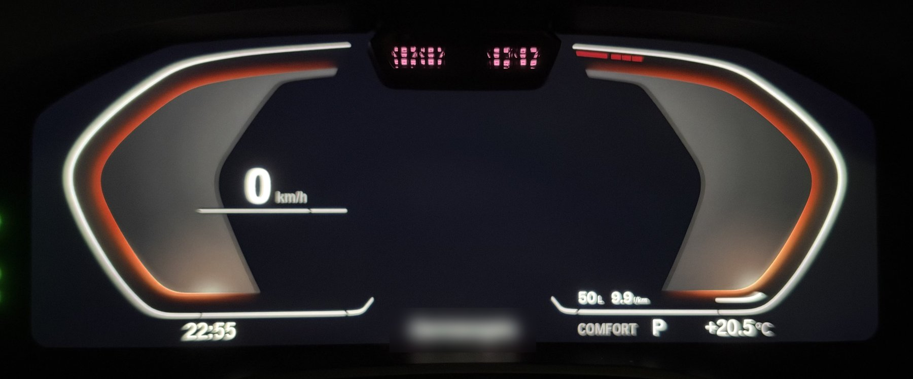

# barin-fuel: minimalist readouts for the BMW iDrive 7 cluster

A small [MGU Store](https://github.com/robertnisipeanu/mgu-store) tool for BMW cars with iDrive 7. The idea is a
**minimalist cluster**: keep BMW's clean factory look and add only the few numbers you actually need, small and in
BMW's own style, so it looks factory-made rather than a full redesign. Everything else on the cluster stays as it is.



- **Average fuel consumption** from the board computer, coloured by value: **below 9** blue, **9 to 10.5** white,
  **above 10.5** yellow (l/100km).
- **Litres left in the tank** (`tank_enabled`), averaged over 10 s so it does not jump in corners. Turns yellow at
  70 km of range or less and red at 50 km or less.
- **Oil warm-up** (`oil_enabled`): a blue oil can with the oil temperature while the oil is below 80°. At 80° it turns
  green for 4 seconds and goes away until the next cold start (oil back below 70°).

Litres and oil are **off by default** and switched on from a USB stick (below).

How it works:

- **Where the numbers come from:** the cluster's own board computer, `KombiIF.statusBordcomputerAverage`
  (`consumptionAverage1BC1` or `consumptionAverage2BC2`, step 0.1), `KombiIF.statusRangeTankStatus`
  (`fluidLevelFuelTank`, `range`) and `CDS.statusEngineTemperature`. Nothing is calculated.
- **How it draws:** through [cluster-render](https://github.com/robertnisipeanu/idrive-apps) (Cluster renderer), one
  `overlay` image layer per readout on the `panel` target.
- **Read-only:** it only reads from the car and sends no commands to any control unit.
- **No SSH needed:** settings come from a USB stick.
- **Font:** Inter (SIL OFL 1.1), the closest free match to BMW Type Next, pre-baked into glyph masks.

Tested on a 2023 BMW 840 Coupe (G15) with Cluster renderer 0.6.0 and Waze on cluster 0.10.0: the Waze map in
the middle of the cluster and these readouts work together.

## Install

1. In the Store, **Cluster renderer** must be installed: source `robertnisipeanu/idrive-apps` (there by default).
2. In the Store: **Settings** → **Add source** → `barinOdUa/bmwcluster`, channel **branch** (branch `main`).
3. Install **Fuel on cluster** (barin-fuel), then restart the head unit (Settings → **Restart head unit**).

New versions arrive in the Store as updates: press **Update**, the Store restarts the tool by itself.

## Setup on a G15

While a layer of an app is on the cluster, BMW moves "COMFORT P" down into the bottom strip. On the G15 the litres
start at the black mark on the white line above COMFORT, the consumption follows right after, both the size of
COMFORT; the oil can sits centred under the "0" of the speed:

```json
{ "scale": 0.71, "align": "left", "x": 1302, "y": 594, "tank_x": 1227, "tank_y": 594,
  "unit_label": "l/km", "unit_scale": 0.8, "oil_enabled": true, "tank_enabled": true,
  "oil_x": 423, "oil_y": 414, "oil_align": "center" }
```

The full file: `dev/config-g15.json`. Other models may need other positions.

## USB stick

Create a folder **`barin-fuel`** in the root of the stick. The tool leaves sticks without this folder alone.

| File | Written by | What it is |
|---|---|---|
| `barin-fuel/config.json` | you | settings; picked up in about 10 seconds and kept in the car, so the stick can be removed |
| `barin-fuel/report.txt` | the car | what the tool sees: BC1 and BC2, Cluster renderer's state, a log |
| `barin-fuel/fonts.txt` | the car | fonts found on the head unit (2 minutes after start) |

`config.json` **replaces** all settings, so put every key you want in it. On the G15 the head unit mounts USB sticks
read-only, so `report.txt` and `fonts.txt` may not appear.

### First run: find the spot

Put `barin-fuel/config.json` on the stick:

```json
{ "test_pattern": true, "oil_enabled": true, "tank_enabled": true }
```

A frame with sample values shows for every readout that is on. Move them with `x` / `y`, `tank_x` / `tank_y`,
`oil_x` / `oil_y` (cluster pixels 1920×720, the frame's top-left corner). Once they sit right, remove `test_pattern`
or set it to `false`.

### All settings

| Key | Default | What it does |
|---|---|---|
| `x`, `y` | 1230, 652 | the consumption frame's top-left corner on the cluster |
| `w`, `h` | 300, 60 | the frame's size |
| `baseline` | 46 | the text baseline from the frame's top |
| `gap` | 6 | between the number and its unit |
| `align` | `"left"` | `"left"`: the text starts at `x`; `"right"`: it ends at `x + w`; `"center"`: centred in the frame |
| `scale` | 1 | 0.3-2, the text bigger or smaller |
| `oil_scale`, `tank_scale` | 0 | own size for oil and litres; 0 - as `scale` |
| `oil_align`, `tank_align` | `""` | own alignment; empty - as `align` |
| `counter` | 1 | 1 or 2: which board computer counter to show |
| `show_unit` | true | show the consumption's unit |
| `unit_label` | `""` | own unit text, e.g. `"l/km"`; empty - as the car says (`l/100km`) |
| `unit_scale` | 1 | 0.5-1.5, the size of the consumption's unit |
| `color_by_value` | true | colour by value (l/100km only); `false`: always `color` |
| `low_below` | 9 | below this - `color_low` |
| `high_above` | 10.5 | above this - `color_high`; between them, both ends included - `color_mid` |
| `color_low` | `"blue"` | |
| `color_mid` | `"white"` | as BMW's own strip |
| `color_high` | `"yellow"` | |
| `color` | `"white"` | with no value, other units or `color_by_value: false` |
| `oil_enabled` | false | oil warm-up |
| `oil_x`, `oil_y`, `oil_w`, `oil_h`, `oil_baseline` | 560, 460, 220, 60, 46 | its frame (under the speed) |
| `oil_warm_c` | 80 | the oil is warm from this temperature |
| `oil_rearm_c` | 70 | below this the icon comes back (cold start) |
| `oil_flash_s` | 4 | seconds shown in green |
| `oil_color_cold`, `oil_color_warm` | `"blue"`, `"green"` | colours |
| `tank_enabled` | false | litres in the tank |
| `tank_x`, `tank_y`, `tank_w`, `tank_h`, `tank_baseline` | 1260, 460, 200, 60, 46 | its frame (under COMFORT) |
| `tank_color` | `"white"` | colour |
| `tank_yellow_km`, `tank_red_km` | 70, 50 | at this range (km) or less the litres turn yellow / red |
| `tank_color_yellow`, `tank_color_red` | `"yellow"`, `"red"` | these colours |
| `test_pattern` | false | frames and sample values always shown, for placing |
| `hidden` | false | `true`: draw nothing without uninstalling |

A colour is a name (`white`, `blue`, `yellow`, `amber`, `teal`, `green`, `red`, `orange`) or RGB, each number 0-1:
`[1, 0.69, 0.29]`. For example, other thresholds and red instead of yellow:

```json
{ "low_below": 8.5, "high_above": 11, "color_high": "red" }
```

### Which counter is "since start"

`report.txt` ("values over time") logs BC1 and BC2 on every change. Compare them with the board computer's
"since start" value and set `counter` to the one that matches.

## Remove

In the Store: open **Fuel on cluster** → **Remove**, then restart the head unit.

## Development

```bash
node --test test/barin-fuel.test.js
```

```bash
uv run --no-project --with pillow python dev/bake_font.py
```

`bake_font.py` bakes the font's characters into `tools/barin-fuel/glyphs.json` (the car runs Node 8 with no font
rasteriser). The font file goes into `dev/font-src/` and is not part of the repo. The tool's code is Node 8: no `?.`
and no `??`.

Built on open projects: `cauliflowermossgrape/idrive7-apps` (MIT), `robertnisipeanu/idrive-apps` (Cluster renderer),
`asloocod/bmw-mgu-apps-public` (an example of a tool over the stock cluster). Details in `tools/barin-fuel/NOTICE`.

## License

MIT, see `LICENSE`. Third-party parts keep their own licences, see `tools/barin-fuel/NOTICE`.
